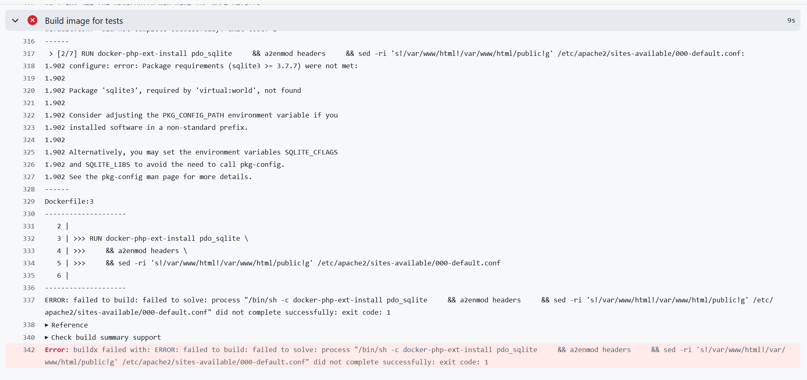
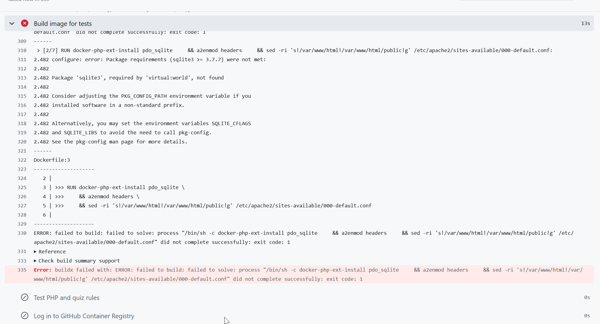
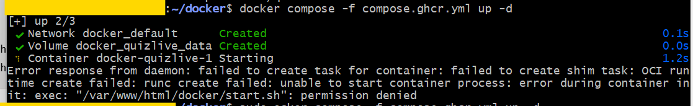

Premier promt, avec ChatGPT 6 Élevé fin octobre 2026

Les premiers prompts ont été faits en Speech to text avec l'appli mobile Android de ChatGPT. C'était dans une soirée pour faire une démo live à quelqu'un sur la capacité de l'IA à produire des applications rapidement. C'est pour cela que les prompts sont mal écrits, avec langage familier
Par la suite on est passés sur ordinateur pour affiner l'application et on ne sera plus en speech to text. Pour info, j'appelle mon IA Kitt comme dans la série TV K2000.
Je ne mets pas les réponses d'IA car ce serait trop long et je n'en ai pas besoin.

```
Kit, une autre question, euh... Si je te demande de faire une application, euh... qui génère un QR code à partager à des utilisateurs, euh... , pour qu'ils puissent le scanner, est-ce que c'est une lib standard pour euh... pour le générer QR ? C'est compliqué à faire une appli web qui génère des QR codes euh... d'accès, merde, comme token d'accès
```

```
Euh... Une seule appli pour plusieurs personnes qui accèdent à un quiz... Et après, euh... bah chaque personne doit être euh... identifiée pour pour participer au quiz, mais euh... ça peut rester local au device de chaque personne euh... Je je veux juste euh... pouvoir envoyer les questions, euh... sur euh... via une page web, je veux que quand je passe à la question suivante, ça passe à la question suivante pour euh... toutes les personnes qui se sont connectées à l'atelier via le QR code
```

```
Euh... Ils doivent répondre sur leur smartphone euh... , comme dans Kahoot, les réponses de chaque participant doivent être stockées euh... bah sur le serveur et à la fin euh... il faut afficher euh... le le podium euh... des... Voilà, le podium de de ceux qui ont le mieux répondu
```

```
Euh... , un chrono par question, c'est pas mal comme dans Kahoot avec la vitesse qui compte. Et euh... il y aura à peu près cinquante utilisateurs. Euh... Est-ce que ça pose problème euh... avoir juste un JSON synchronisé euh... en PHP côté serveur, ça pose pas de problème s'il y a cinquante utilisateurs euh...
```

```
Euh... , oui, euh... un petit Kahoot euh... perso, PHP, VueJS, SQLite, ça me va bien. Euh... Et euh... donc le le QR code, et il faut que ça soit euh... responsive, donc utilisable sur smartphone parce que les gens, ils vont scanner le QR code et accéder au site en web sur smartphone, pas besoin de faire une PWA, juste euh... juste via le navigateur web. Et ça me va des quatre quatre réponses par question euh... et euh... les questions réponses dans un fichier JSON, ça me va aussi. Euh... Est-ce que tu peux... me coder cette application entièrement euh... , mais euh... avec un code de qualité. Euh... Donc là, je te mets en effort euh... , effort élevé pour que tu codes une application simple, efficace, sans bug euh... , directement
```

```
Euh... , bah, si on raccroche, est-ce que tu vas quand même coder l'application directement dans la même conversation ?
```

```
OK, ouais, génère-moi tous les fichiers, euh... ça, ça marche
```

```
Kit, est-ce que tu nous diras quand le code sera terminé T'es en train de coder, là ?
```

```
Mais t'es en train de coder en arrière-plan, hein, on est d'accord
```

```
Euh... bah oui, euh... , génère les fichiers, s'il te plaît
```

```
Attends, Kit, on va arrêter l'appel et je vais t'écrire en texte, je vais te demander de générer les fichiers
```

# Passage en mode clavier au lieu de Speech to Text

```
Maintenant, est-ce que tu peux générer l'application complète et de bonne qualité, conformément à la spec qu'on a définie, s'il te plaît ?
```

# Evolutions, principalement dans un but de déployer et exploiter l'appli

```
J'ai mis tout le code dans Github. Ce que je veux faire maintenant c'est définir une clé ADMIN dans un secret github. Dis-moi comment définir et utiliser le secret github car j'ai oublié. Je veux également un workflow git pour créer l'image et la déposer sur GHCR
```

```
j'ai pas openssl est-ce que tu peux me générer une clé ou me dire comment le faire sous windows 11, je peux rien installer sous windows
```

```
donne moi une clé directement stp
```


```
Le workflow GitHub Action s'est lancé mais j'ai l'erreur suivante :
```


```
J'ai fait ta correction mais j'ai cette erreur
```


```
Quand je fais docker compose sur mon serveur, j'ai cette erreur (capture d'écran)
```

```
L'image est lancée sur mon serveur AWS. Maintenant je veux configurer un sous domaine dans hostinger et caddy. Redonne-moi la procédure stp (on l'a déjà fait)
```

```
comment relancer une nouvelle création du conteneur quizlive (et supprimer l'ancien)
```

```
donne moi une clé d'admin de 16 caractères pour tester l'appli
```

```
décris-moi le format du fichier des questions pour notre petite application car je veux utiliser ce format dans un autre prompt pour faire rédiger des questions
```